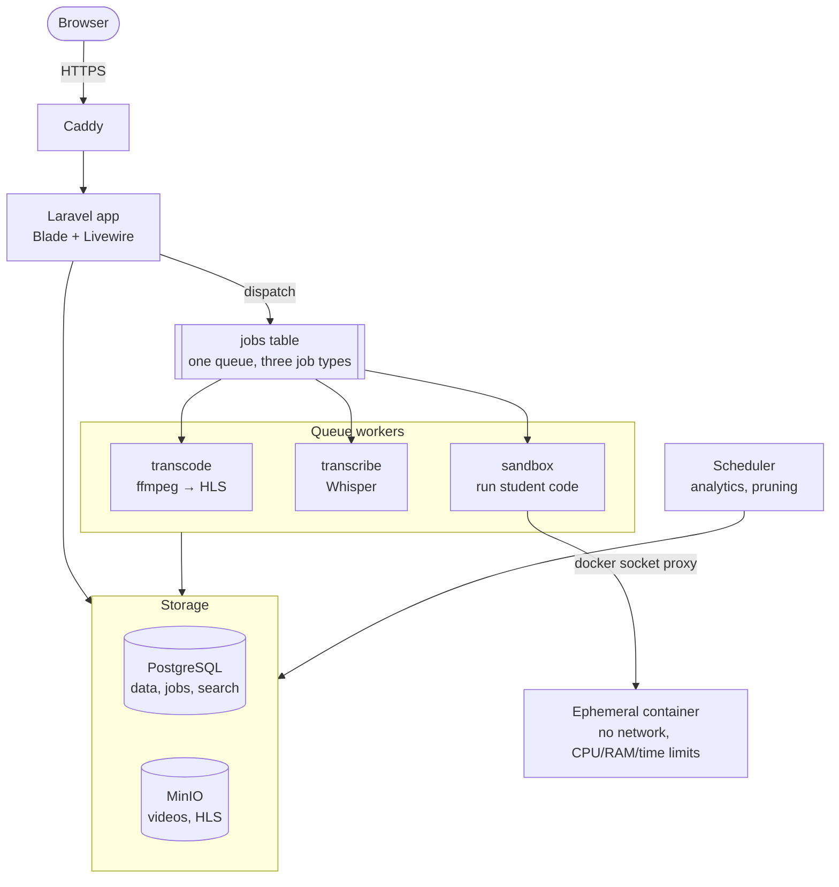

# Annual Project - Code Learning Platform

ESGI 3IWJ annual project (2025-2026) by Lucas, Sorya and Yohan.

A self-hostable SaaS platform for learning to code. Courses combine indexed videos, written lessons and code exercises that are run and graded automatically. Teachers get indicators showing where their students get stuck.

## Business problem

Learning to code from videos is often passive:

- You cannot find a specific passage in a video.
- Questions are not linked to the exact moment of the video they are about.
- Exercises are corrected by hand, so feedback is slow.
- Tools are scattered (video platform, online editor, LMS), and the teacher does not know where students drop off or fail.

## Solution

The platform brings these uses together around three pillars:

- **Indexed video:** videos are transcribed automatically, searchable down to the second, and can be commented at a precise timecode.
- **Executed exercises:** student code runs in an isolated container and is graded automatically by tests.
- **Teachers see where students get stuck:** drop-off curve per video, failure rate per exercise.

## Actors

- **Student:** follows a path of lessons, watches videos, searches transcripts, comments at a timecode, submits exercises and follows their progress.
- **Teacher:** creates and manages courses, lessons, videos, exercises and tests, defines prerequisites, answers comments and reads the analytics of their courses.
- **Administrator:** manages users, courses, comment moderation and the quotas of their organisation.

## Main features

- Authentication and roles.
- Multi-tenant organisations with data isolation.
- Course catalogue with categories.
- Lessons with video (HLS streaming), text content and exercises.
- Automatic video transcription and full-text search.
- Comments linked to a video timecode, with teacher replies.
- Code exercises run in a sandbox and graded automatically.
- Quizzes and learning paths with prerequisites between lessons.
- Student progress tracking.
- Analytics dashboard for teachers.
- Responsive interface for desktop and mobile.

## Business rules

- A user must be logged in to comment, submit code or access private content.
- A course must contain at least one lesson before it is published.
- A lesson can contain a video, text, an exercise, or any combination of the three.
- A video is only visible once its transcoding is finished.
- A lesson stays locked until its prerequisites are validated; prerequisites cannot form a cycle.
- Submitted code only runs in an isolated sandbox, with no network and with CPU, memory and time limits.
- Comments must follow moderation rules.
- Teachers can only edit their own courses, unless they are an administrator.
- The data of an organisation is never accessible from another organisation.
- Each organisation has quotas (video storage, code executions).

## Tech stack

| Layer | Choice |
|---|---|
| Backend | **Laravel** (PHP) |
| Frontend | Blade templates + **Livewire** and Alpine.js, built with Vite (no React, Vue or Angular, per the syllabus) |
| Database | **PostgreSQL**: application data, the job queue and full-text search |
| Background jobs | Laravel queues with the `database` driver, one worker per queue |
| File storage | MinIO (S3-compatible) through Laravel's `s3` disk |
| Video | ffmpeg → HLS streaming, played with hls.js |
| Transcription | Whisper (whisper.cpp, on CPU) |
| Code sandbox | Ephemeral Docker containers with no network and CPU/memory/time/process limits |
| Reverse proxy | Caddy (automatic HTTPS) |
| Infrastructure | Docker + `compose.yml`, on a 5-10 €/month VPS. No paid services. |

The detailed decisions are recorded in `docs/adr/` (#3).

## Architecture

Transcoding, transcription and code execution are three kinds of jobs on **a single queue**. One architecture, three features.



- The app saves a row (a video, a submission) and dispatches its job in the same transaction.
- Workers take jobs with `SELECT ... FOR UPDATE SKIP LOCKED`, so two workers never take the same job.
- Each kind of job has its own queue and worker. A long transcription never delays a student waiting for their code result.
- The interface shows the status stored on the row (`videos.status`, `submissions.status`), refreshed with Livewire polling (the syllabus does not allow WebSockets).

## Data model

See [docs/data-model.md](docs/data-model.md): diagrams of every table and the reasons behind each abstraction (shared database with an `organization_id` global scope, roles on memberships, lessons with optional typed content, timed transcript segments, prerequisites as a graph, one queue).

## Scope

- **MVP (29/11/2026):** authentication and roles, courses and lessons, complete video pipeline, comments, progress, deployed over HTTPS.
- **V1 (final delivery, 13/12/2026):** sandbox and automatic grading, transcription and search, timecoded comments, prerequisites, analytics, multi-tenant.
- **Extensions if time allows:** spaced repetition, chaptering, plagiarism detection, billing.

If time runs short, secondary features are reduced without touching the core of the project: the video pipeline and code execution.

## Risks

- **Transcription without a GPU:** Whisper runs on CPU, so slowly. The queue makes it asynchronous, and we measure and document the transcription time per hour of video.
- **Sandbox security:** a container shares the host kernel. Hardening: non-root user, read-only file system, no network, seccomp, CPU/memory/time limits, process limit (`--pids-limit`), gVisor as an option.

## Syllabus requirements

| Requirement | How we meet it |
|---|---|
| Agile project management with a tracking tool | One-week sprints on a [GitHub Project board](https://github.com/users/lucaszebre/projects/12) |
| Git with a branch workflow | Lightweight Gitflow, protected `main` and `develop`, reviewed pull requests |
| Wireframes and mockups | Figma/Penpot (#4, #5, #6) |
| Justified SQL data model | [docs/data-model.md](docs/data-model.md) |
| Responsive interface without React, Vue or Angular | Blade + Livewire |
| Backend with business logic | Laravel: policies, actions, jobs |
| Docker and `compose.yml` | Every service containerised, dev and production |
| Public deployment with a domain and SSL | VPS + Caddy (Let's Encrypt) |
| Security (CSRF, SQL injection, XSS, secrets) | Laravel CSRF middleware, Eloquent parameter binding, Blade escaping, no secrets in the repository |

Bonus points we are aiming for: advanced authentication (#47), observability (#48), SEO (#49), deployment automation (#50), clustering (#51).

## Getting started

The Laravel application and its Docker setup arrive with #8 and #9. Once they are merged:

```sh
cp .env.example .env
docker compose up -d
docker compose exec app php artisan key:generate
docker compose exec app php artisan migrate --seed
```

## Deliverables

- Business document (2 pages).
- Wireframes and mockups.
- SQL data model and its justification.
- Source code in this repository.
- Docker configuration.
- Deployed application with a public URL and SSL, available the week before and the week after the final presentation.
- Final presentation: a 30-minute live demonstration.

Final delivery: Sunday 13/12/2026, 23:59.

## Team

| Member | GitHub |
|---|---|
| Lucas | [@lucaszebre](https://github.com/lucaszebre) |
| Sorya | [@Paulineente](https://github.com/Paulineente) |
| Yohan | [@YohanetYoyo](https://github.com/YohanetYoyo) |

Everyone works on frontend, backend and infrastructure, as the syllabus requires.

## Contributing

See [CONTRIBUTING.md](CONTRIBUTING.md) for the branch workflow, commit conventions, Definition of Done and sprint organisation. Tasks are tracked on the [project board](https://github.com/users/lucaszebre/projects/12).
