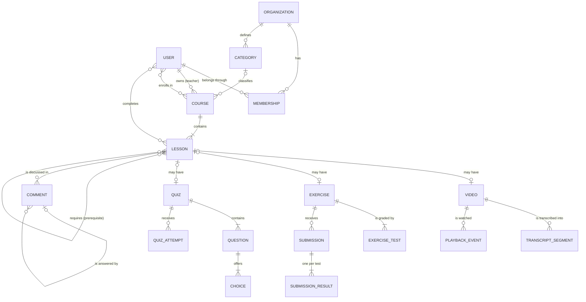
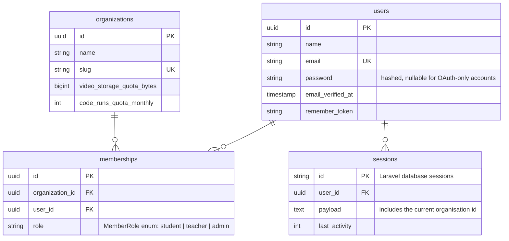
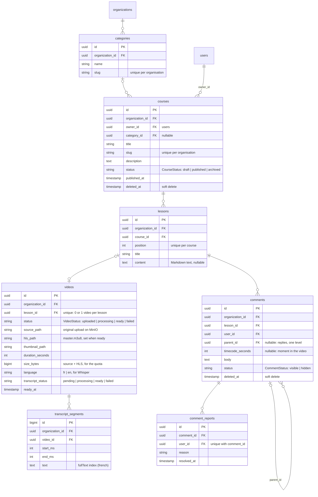
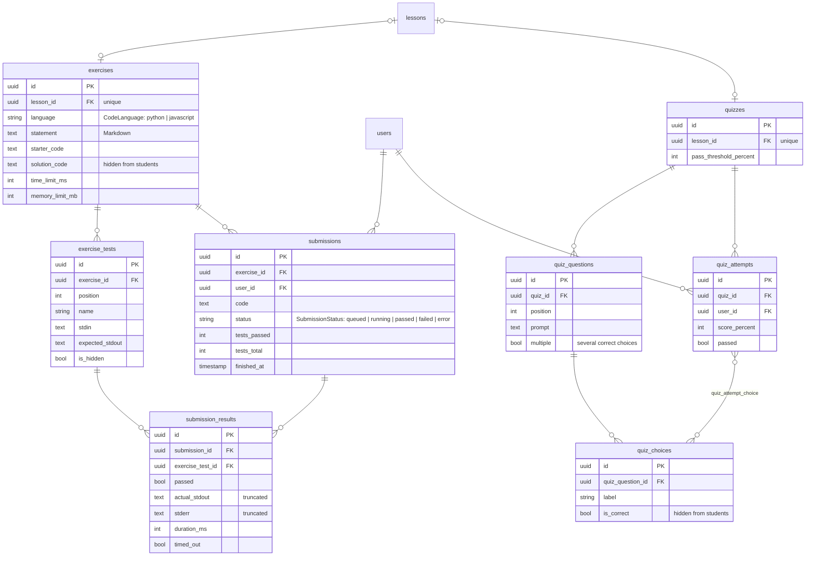
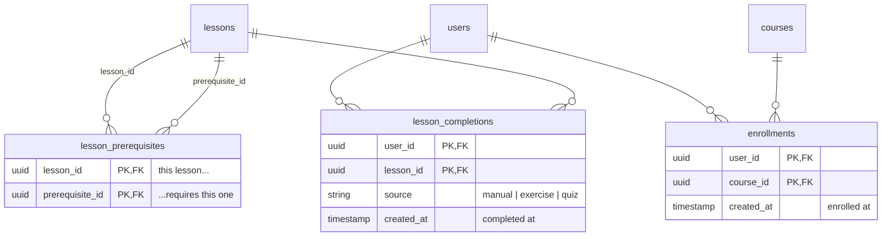
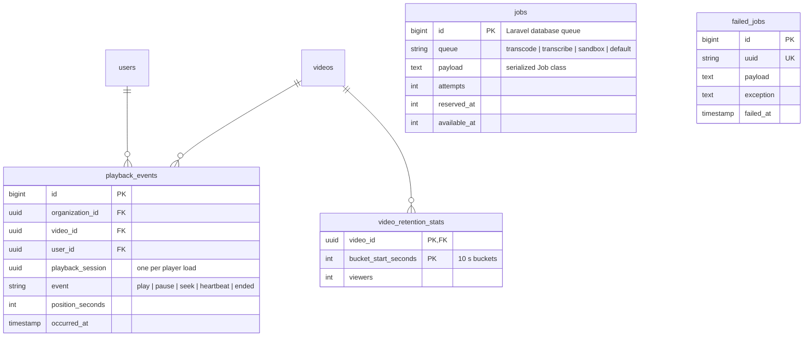

# Data model

The database of the code learning platform, drawn before implementation, with the reasons behind each abstraction. This is the document we defend at the final presentation (syllabus › Modélisation). The tables will be implemented later as Laravel migrations and Eloquent models.

Target: **Laravel 12+** with **PostgreSQL** (needed for full-text search with French stemming).

## 1. Conventions

- Laravel naming: plural `snake_case` tables, `id` primary key, foreign keys named `<model>_id` (so `foreignUuid('course_id')->constrained()` finds `courses` by itself).
- Every table has `created_at` / `updated_at` (`$table->timestamps()`); they are not repeated in the diagrams.
- Primary keys are **UUIDs** (`HasUuids` trait, which generates ordered UUID v7 since Laravel 12), except for the two high-volume internal tables `transcript_segments` and `playback_events`, which use a normal auto-increment `id()`.
- Status columns are strings backed by **PHP enums** (`VideoStatus::Ready`) and cast in the model.
- Files (videos, HLS playlists, thumbnails) live on the `s3` disk (MinIO). The database only stores their **paths**.

## 2. Overview (conceptual model)

What exists and how it is related, without technical columns.



A draft course can be empty, but a course needs at least one lesson to be **published**.

## 3. Detailed diagrams

Every tenant table has an `organization_id` column (see [decision 4.1](#41-organisations-one-database-shared-by-all-organisations)); it is shown only where it matters.

### 3.1 Organisations and users



`memberships` has a unique index on `(organization_id, user_id)`.

### 3.2 Courses, lessons, videos and comments



### 3.3 Exercises and quizzes



### 3.4 Learning path and progress



### 3.5 Analytics and background jobs



`jobs` and `failed_jobs` are Laravel's own tables (`php artisan make:queue-table`); they have no relation to the domain tables because a job only carries the ids it needs in its payload.

## 4. Abstraction decisions

Each choice below lists what we considered and why we picked one.

### 4.1 Organisations: one database shared by all organisations

Business rule: *the data of an organisation is never accessible from another organisation.*

| Option | Verdict |
|---|---|
| One database per organisation (e.g. `stancl/tenancy`) | Strongest isolation, but N databases to migrate and back up on a small VPS. Too heavy. |
| One schema per organisation | Same problem, and harder to explain. |
| **One shared database, `organization_id` on every tenant table** | **Chosen.** One migration, one backup, and Laravel makes the filtering automatic. |

How it works in Laravel:

- A `BelongsToOrganization` trait, used by every tenant model, adds a **global scope** `where organization_id = <current organisation>` and fills `organization_id` automatically on `creating`. Developers cannot forget the filter: `Course::find($id)` on a course of another organisation returns `null`, so route model binding gives a 404.
- A middleware resolves the current organisation from the session and refuses the request if the user is not a member of it.
- Validation uses `Rule::exists('courses', 'id')->where('organization_id', ...)`, so an id from another organisation cannot be submitted in a form.
- Feature tests check, for every resource, that a user of organisation A gets a 404 on organisation B's data.

Why `organization_id` is repeated on child tables (`lessons`, `videos`, `comments`...) when it could be reached through `course_id`: the global scope works on one table without joins. It is a small, deliberate redundancy that makes every query safe by default.

`users` is global (not scoped) because login happens before we know the organisation.

### 4.2 Roles: a `memberships` table, not a column on `users`

The same person can be a teacher in one organisation and a student in another, so the role belongs to the link between a user and an organisation:

```php
// User.php
public function organizations(): BelongsToMany
{
    return $this->belongsToMany(Organization::class, 'memberships')
        ->using(Membership::class)
        ->withPivot('role');
}
```

We considered `spatie/laravel-permission`. It is well suited to many fine-grained permissions, but we only have three fixed roles, and its tables would add complexity for no gain. A `MemberRole` PHP enum on the pivot plus **Policies** (`CoursePolicy::update`: owner or admin) covers the rules and is easy to explain.

### 4.3 Lessons: one container with optional typed content

Rule: *a lesson can contain a video, text, an exercise, or a combination of the three.*

| Option | Verdict |
|---|---|
| A JSON `content` column | No foreign keys, no constraints, hard to query. |
| Polymorphic content blocks (`lesson_items` with `morphTo`) | Very flexible (any number of blocks, any order), but Eloquent polymorphic relations cannot have real foreign keys, and every screen must branch on the block type. Flexibility we do not need. |
| **A `lessons` table with `content` (text) + optional `videos`, `exercises`, `quizzes` linked 1-to-1** | **Chosen.** Each content type has its own columns (`duration_seconds`, `time_limit_ms`...), real foreign keys, and simple relations: `$lesson->video`, `$lesson->exercise`. |

The 1-to-1 is enforced with a unique index on `lesson_id`. If we later want several exercises per lesson, we only remove that unique index and change `hasOne` to `hasMany`.

### 4.4 Videos: a status, and paths instead of files

Rule: *a video is only visible once its transcoding is finished.*

- `status` follows `uploaded → processing → ready | failed`. A local scope `Video::ready()` is used for everything students see, and `hls_path` is only set when the transcode job succeeds.
- The database stores **paths** on the MinIO disk, never URLs or files. The application generates temporary signed URLs (`Storage::temporaryUrl()`), so videos are never public and the storage can move without a data migration.
- `size_bytes` feeds the video storage quota: `Video::sum('size_bytes')` for the organisation.

### 4.5 Transcripts: segments, not one big text

Whisper returns timed segments. We keep them as rows (`start_ms`, `end_ms`, `text`) instead of one text per video because that is what makes search "precise to the second": each search hit is a segment, so we can open the video at `start_ms`. The same rows produce the subtitle file (WebVTT).

Search uses PostgreSQL full text, natively supported by Laravel, instead of a search engine like Meilisearch or Elasticsearch:

```php
$table->fullText('text')->language('french');                    // migration: GIN index
TranscriptSegment::whereFullText('text', $q, ['language' => 'french'])->get(); // query
```

French stemming means "fonctions récursives" also finds "une fonction récursive". One less service to run on the VPS.

### 4.6 Comments: one table for questions, answers and timecoded comments

- Replies use `parent_id` (self-relation) with **one level** only: a student asks, the teacher answers. Deeper threads would complicate the UI for no real need. The rule is checked in the Form Request.
- `timecode_seconds` is nullable: a comment is either about the whole lesson or about a moment of the video. No separate table for "timecoded comments": same data, same moderation.
- We did not make comments polymorphic (`commentable`): they only ever target lessons, and a normal foreign key keeps integrity.
- Moderation: `status` (`visible` / `hidden`) for moderators, `SoftDeletes` for deletion (so a deleted question does not break the thread of answers), and `comment_reports` (unique per user and comment) for reports.
- Comments are stored as typed and escaped on output by Blade (`{{ }}`), which protects against XSS.

### 4.7 Code exercises: input/output tests

- A test is a row with `stdin` and `expected_stdout`: the sandbox runs the student's program, sends `stdin`, compares the output. It works the same for every language, and the sandbox image does not need a test framework.
- `is_hidden` tests and `solution_code` never leave the server (excluded with `$hidden` on the model and in API resources). Students see whether a hidden test passed, not its content.
- One `submission_results` row per test gives the teacher the failure rate **per test**, not only per exercise.

### 4.8 Learning path: prerequisites as a graph

Rule: *a lesson stays locked until its prerequisites are validated; prerequisites cannot form a cycle.*

`lesson_prerequisites` is a self-referencing many-to-many on `lessons`:

```php
public function prerequisites(): BelongsToMany
{
    return $this->belongsToMany(Lesson::class, 'lesson_prerequisites', 'lesson_id', 'prerequisite_id');
}
```

This allows a real graph (a lesson can require two others), not only a linear order. Before saving an edge, a `PrerequisiteGraph` service walks the existing prerequisites and refuses the edge if it would close a loop. It runs in a transaction that locks the course, so two teachers cannot each create half of a cycle at the same time.

A lesson is **unlocked** when all of its prerequisites appear in the student's `lesson_completions`. This is computed, not stored.

### 4.9 Progress: store completions, compute percentages

A row in `lesson_completions` means "this user completed this lesson", with its `source` (`manual` for text/video, `exercise` or `quiz` when validated automatically). Course progress (completed lessons / lessons) is **computed** on the fly. Storing a percentage would go wrong as soon as a teacher adds a lesson.

`enrollments` records which courses a student follows: it drives the "my learning" page and is the denominator for analytics.

### 4.10 Analytics: raw events + pre-computed results

- The player sends `playback_events` (play, pause, seek, a heartbeat every ~10 s). This is by far the largest table, so it has a plain `bigint` id, an index on `(video_id, occurred_at)`, and uses Laravel's **`MassPrunable`** to delete events older than a few months with a scheduled `model:prune`.
- Computing the drop-off curve from raw events on every dashboard load would be slow, so a scheduled job aggregates it into `video_retention_stats` (viewers still watching per 10-second bucket).
- The failure rate per exercise is computed directly from `submissions` and `submission_results`, which are small enough.

### 4.11 Background jobs: one queue, three kinds of work

The central argument of the project: transcoding, transcription and code execution are three kinds of jobs on **one** queue.

We use Laravel's **database queue driver**: one `jobs` table in PostgreSQL, no Redis or RabbitMQ. Workers take jobs with `SELECT ... FOR UPDATE SKIP LOCKED`, so several workers never take the same job.

| Job class | Queue | Updates |
|---|---|---|
| `TranscodeVideo` (ffmpeg → HLS) | `transcode` | `videos.status`, then dispatches `TranscribeVideo` |
| `TranscribeVideo` (Whisper) | `transcribe` | `videos.transcript_status`, `transcript_segments` |
| `RunSubmission` (Docker sandbox) | `sandbox` | `submissions.status`, `submission_results` |
| `AggregateVideoRetention` (scheduled) | `default` | `video_retention_stats` |

Separate queue names let us run dedicated workers (`queue:work --queue=sandbox`): a long Whisper transcription never delays a student waiting for their code result. The UI never reads the `jobs` table. It shows the status of the domain row (`videos.status`, `submissions.status`), which the job updates.

### 4.12 Quotas: two columns on `organizations`

Rule: *each organisation has quotas (video storage, code executions).*

Quotas are two columns on `organizations` rather than a separate 1-to-1 table: there are only two numbers and they are always read with the organisation. Usage is computed from existing data (sum of `videos.size_bytes`, count of this month's `submissions`), so there is no counter to keep in sync.

### 4.13 UUIDs instead of auto-increment ids

- `/courses/42` invites trying `/courses/43`. A UUID cannot be guessed. Authorisation is still checked by Policies; this is an extra layer.
- Laravel's `HasUuids` generates **ordered** UUIDs (v7), which start with a timestamp, so new rows are inserted at the end of the index like an auto-increment.
- Internal high-volume tables (`transcript_segments`, `playback_events`) keep `bigint` ids: they never appear in URLs and are smaller to index.

## 5. Business rules → where they are enforced

| Business rule (project brief) | How, in Laravel |
|---|---|
| Must be logged in to comment, submit code or access private content | `auth` middleware on the routes |
| A course needs ≥ 1 lesson before publication | `PublishCourse` action checks `$course->lessons()->exists()` |
| A lesson can contain a video, text, an exercise, or a combination | Nullable `lessons.content` + optional `hasOne` video / exercise / quiz (unique `lesson_id`) |
| A video is only visible once transcoding is finished | `VideoStatus` enum, `Video::ready()` scope, `hls_path` set only by `TranscodeVideo` |
| A lesson is locked until its prerequisites are validated | `LessonPolicy::view` checks prerequisites against `lesson_completions` |
| Prerequisites cannot form a cycle | `PrerequisiteGraph` service, in a locked transaction, plus a unique `(lesson_id, prerequisite_id)` |
| Submitted code only runs in an isolated sandbox | Only the `RunSubmission` job executes code, in an ephemeral Docker container (#28) |
| Comments follow moderation rules | `StoreCommentRequest` validation + content filter, `status`, `comment_reports`, `SoftDeletes` |
| Teachers only edit their own courses, unless admin | `CoursePolicy::update`: `owner_id` or admin role in `memberships` |
| An organisation's data is never reachable from another one | `BelongsToOrganization` global scope, organisation middleware, scoped `exists` validation, feature tests |
| Each organisation has quotas | Quota columns on `organizations`, checked before upload and before dispatching `RunSubmission` |

## 6. Open points for the team

- **PostgreSQL** rather than MySQL: needed for `fullText` with French stemming. OK for everyone?
- **Exercise languages:** Python and JavaScript to start?
- **One exercise per lesson** for V1: OK, or do we want several?
- **OAuth (bonus #47):** would add an `oauth_accounts` table, or use Laravel Socialite with `provider` / `provider_id` columns on `users`.
