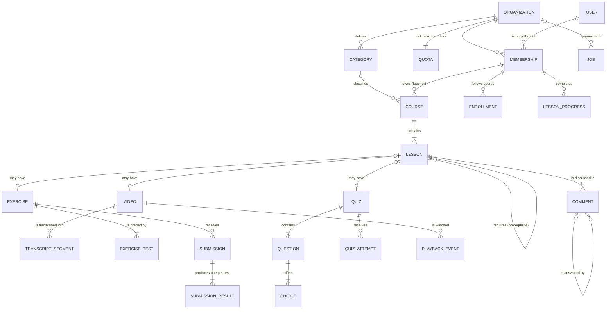
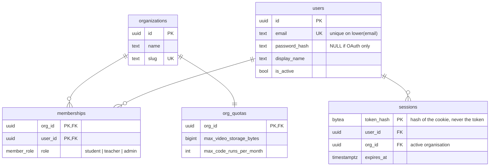
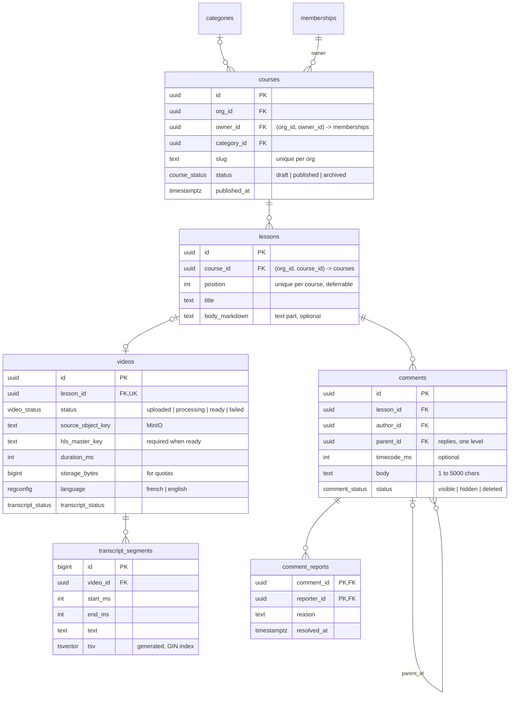
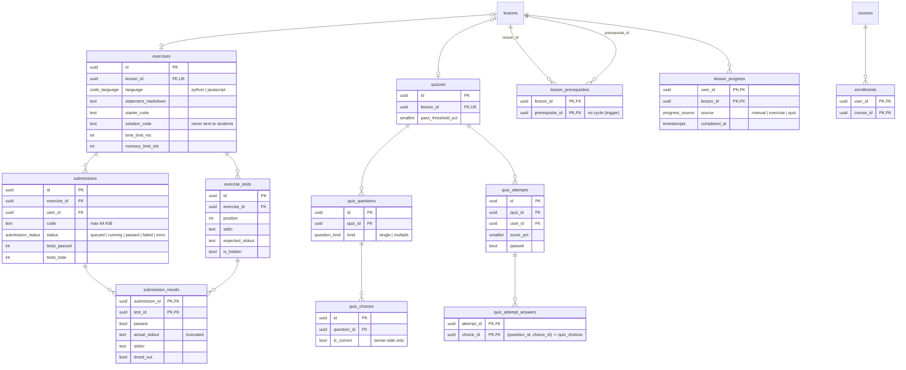
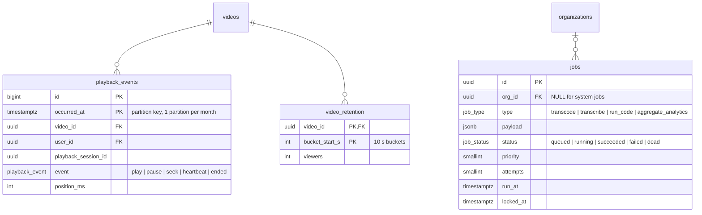

# Data model

The SQL data model of the code learning platform, and why it looks this way. This is the document we defend at the final presentation (syllabus › Modélisation).

- Reference DDL: [`data-model/schema.sql`](data-model/schema.sql) (PostgreSQL 18)
- Executable checks of the business rules: [`data-model/checks.sql`](data-model/checks.sql)

```sh
docker run -d --rm --name pg -e POSTGRES_PASSWORD=test -p 55432:5432 postgres:18
PGPASSWORD=test psql -h localhost -p 55432 -U postgres -v ON_ERROR_STOP=1 -q \
  -f docs/data-model/schema.sql -f docs/data-model/checks.sql
# ... "All data model checks passed."
```

## 1. Choices in one page

| Decision | Choice | Main reason |
|---|---|---|
| Database | PostgreSQL only | Relational data with strong rules, and the same database also runs the job queue and full-text search: one service to run on a 5-10 €/month VPS. |
| Multi-tenancy | Shared schema, `org_id` on every tenant table, row-level security | Isolation is enforced by the database even if the API has a bug, without running one database per customer. |
| Cross-tenant integrity | Composite foreign keys `(org_id, id)` | A lesson cannot point to a course of another organisation; not even by mistake. |
| Users | Global `users` + `memberships(org_id, user_id, role)` | The same person can teach in one organisation and study in another. |
| Primary keys | `uuidv7()` | Not guessable in URLs (limits IDOR attempts), time-ordered so inserts stay index-friendly. |
| Lesson content | Optional 1-to-1 tables: `videos`, `exercises`, `quizzes` + `lessons.body_markdown` | Any combination of video / text / exercise is possible, each with real columns and constraints. |
| Search | `tsvector` generated column on transcript segments + GIN index | Search down to the second, with French stemming, without Elasticsearch. |
| Prerequisites | Edge table + trigger that rejects cycles | The graph is guaranteed to stay a DAG. |
| Job queue | One `jobs` table, `FOR UPDATE SKIP LOCKED` | Transcoding, transcription and code execution are three job types on one queue (the central argument of the project). |
| Analytics | Monthly-partitioned `playback_events`, aggregated into `video_retention` | High-volume events are cheap to insert and cheap to delete. |

## 2. Conceptual model

Entities and how they relate, without technical columns.



A course needs at least one lesson to be **published** (drafts can be empty), which the diagram shows as `||--|{` and the database enforces with a trigger.

## 3. Logical model

Tables, keys and the main columns, split by area. All tables except `users`, `sessions` and `jobs` have an `org_id` column, omitted below where it is only there for isolation.

### 3.1 Tenancy and identity



### 3.2 Courses, lessons, videos and comments



### 3.3 Exercises, quizzes, learning path and progress



### 3.4 Analytics and job queue



`exercise_stats` (failure rate per exercise) is a view over `exercises` and `submissions`.

## 4. Justification

### 4.1 Why PostgreSQL, and only PostgreSQL

The domain is strongly relational: an organisation has courses, a course has ordered lessons, a lesson has optional content, students have progress on lessons. Most business rules are relationships ("the owner must be a member", "the answer must belong to the question"), which foreign keys and constraints express better than application code.

PostgreSQL also covers two needs that would otherwise require extra services:

- **Job queue.** `SELECT ... FOR UPDATE SKIP LOCKED` lets several workers take jobs without ever getting the same one. The real benefit is **transactional enqueueing**: the API inserts the `videos` row and its `transcode` job in the same transaction, so a video can never be saved without its job (or the reverse), which is impossible to guarantee with Redis or RabbitMQ next to the database.
- **Full-text search.** `tsvector` with the `french` configuration handles stemming ("fonctions récursives" finds "Une fonction récursive", see `checks.sql`). For a few hundred hours of video, a GIN index is more than enough, and we avoid running Elasticsearch on a small VPS.

Fewer services means a smaller VPS, a simpler `compose.yml`, and one backup to manage.

### 4.2 Multi-tenancy: shared schema with row-level security

Business rule: *the data of an organisation is never accessible from another organisation.*

| Option | Isolation | Cost to run | Verdict |
|---|---|---|---|
| One database per organisation | Very strong | One DB, migrations and backups per customer | Too heavy for us |
| One schema per organisation | Strong | Migrations run N times, connection pool per schema | Complex |
| **Shared schema + `org_id` + RLS** | **Strong, enforced by PostgreSQL** | **One schema, one migration** | **Chosen** |

We use three layers, so a single mistake is never enough to leak data:

1. **`org_id` on every tenant table**, even when it could be found through a join (`lessons.org_id` duplicates `courses.org_id`). That makes each row self-describing, which row-level security needs.
2. **Composite foreign keys `(org_id, x_id) → parent(org_id, id)`.** The database refuses a lesson of org B in a course of org A, even when inserted by an admin script.
3. **Row-level security with `FORCE`.** The API runs `SET LOCAL app.org_id = ...` at the start of each transaction. Every query, including a forgotten `WHERE`, only sees the active organisation. If the API forgets to set it, `current_org_id()` is `NULL` and **no row is returned**: it fails closed.

`users` and `sessions` are global because login happens before we know the organisation. A user can still see their own memberships in other organisations (to switch organisation) through a dedicated policy, and nothing else.

### 4.3 Users and memberships

A role belongs to a **membership**, not a user: the PDF describes a teacher who manages *their* courses inside *an* organisation. Putting the role on `users` would forbid someone from being a teacher in one school and a student in another. `courses.owner_id` references `memberships(org_id, user_id)`, so a course owner is necessarily a member of the course's organisation, and a teacher cannot be removed while they still own courses (ownership must be transferred first).

### 4.4 Identifiers: UUID v7

- Not guessable: `/courses/42` invites trying `/courses/43`; a UUID does not. Authorisation is still checked, this is defence in depth.
- Generated in the database (`uuidv7()`, new in PostgreSQL 18) or the application, without a round trip.
- Unlike random UUID v4, v7 starts with a timestamp, so new rows go to the end of the B-tree index like a serial would.

`transcript_segments` and `playback_events` use `bigint` identities: they are never exposed in URLs and are the highest-volume tables, where 8 bytes beat 16.

### 4.5 Lesson content: one optional table per content type

The rule is "a lesson can contain a video, text, an exercise, or a combination". We chose:

- `lessons.body_markdown` for the text (nullable),
- `videos`, `exercises`, `quizzes` with `lesson_id UNIQUE`: zero or one of each per lesson.

Alternatives we rejected:

- **One `content` JSON column:** no foreign keys, no constraints, no way to say "a ready video must have an HLS playlist".
- **A generic `content_blocks(type, data)` table:** flexible, but every query has to branch on `type`, and type-specific columns (`duration_ms`, `time_limit_ms`) become untyped.

Limiting to one exercise per lesson keeps "lesson completed" simple (pass the exercise ⇒ lesson done). If we need several exercises later, dropping the `UNIQUE` on `exercises.lesson_id` is enough.

### 4.6 Videos

`videos.status` is a small state machine `uploaded → processing → ready | failed`. Rule: *a video is only visible once transcoding is finished*. The API only returns `ready` videos to students, and a `CHECK` makes `ready` impossible without `hls_master_key`, `duration_ms` and `ready_at`: a bug in the worker cannot publish a broken video.

We store **object keys** in MinIO, not URLs: the API generates short-lived signed URLs, so moving storage or changing the domain does not require migrating data. `storage_bytes` (source + HLS renditions) feeds the storage quota.

### 4.7 Transcripts and search

The transcript is stored as **segments** (`start_ms`, `end_ms`, `text`) as returned by Whisper, not as one big text. That is what makes the search "precise to the second": each search hit is a segment, so we can open the video at `start_ms`. The same rows produce the WebVTT subtitles.

`tsv` is a **generated column** `to_tsvector(language, text)`: PostgreSQL computes it on insert, so it can never be out of date. The language (`french` / `english`) is stored per video because stemming depends on it. Since every segment carries `org_id`, search results are filtered by row-level security like everything else (checked in `checks.sql`).

### 4.8 Comments

- `parent_id` (adjacency list) with **one level of replies**, enforced by a trigger. Students ask, teachers answer; deeper threads add UI complexity for no real need.
- `timecode_ms` nullable: a comment can be about the whole lesson or a precise moment of the video. A partial index `(lesson_id, timecode_ms) WHERE timecode_ms IS NOT NULL` serves the markers on the player.
- Moderation: `status` (`visible`, `hidden`, `deleted`) instead of `DELETE`, so a deleted question does not break the thread of answers, plus `comment_reports` (one report per user and comment, primary key `(comment_id, reporter_id)`).
- Body length is checked in the database (1 to 5000 characters). XSS protection happens on output, not storage: we store what the user typed and escape it when rendering.

### 4.9 Code exercises

- Tests are **input/output** (`stdin`, `expected_stdout`): the sandbox runs the program, feeds `stdin`, and compares the output. This is the same for every language and does not require a test framework inside the sandbox image.
- `is_hidden` tests and `solution_code` never leave the server: students see the result of a hidden test (passed / failed), not its content.
- `submission_results` has one row per test, which gives the "failure rate **per test**" for teachers, not only per exercise.
- Outputs are truncated by the runner and limited in the database (16 KiB) so a student's infinite `print` loop cannot fill the disk.
- Code size is limited to 64 KiB.

### 4.10 Learning path: a DAG of prerequisites

`lesson_prerequisites(lesson_id, prerequisite_id)` is an **edge list**: "lesson_id requires prerequisite_id". Rule: *prerequisites cannot form a cycle*. A trigger walks the existing prerequisites with a recursive query and refuses an edge that would close a loop. An advisory lock per organisation prevents two concurrent inserts from each creating half of a cycle.

A closure table (storing every ancestor/descendant pair) would make reads faster but writes complex; with a few dozen lessons per course and rare edits, the edge list is the simpler choice.

Unlocking is computed, not stored: a lesson is unlocked for a student when every prerequisite has a row in `lesson_progress`. The query is in `checks.sql`.

### 4.11 Progress

One row in `lesson_progress` means "this user completed this lesson", with `source` (`manual`, `exercise`, `quiz`). Course progress (completed / total) is **computed**, never stored, so it stays correct when a teacher adds a lesson. `enrollments` records which courses a student follows; it drives "my learning" and is the denominator of the analytics.

### 4.12 Analytics

- `playback_events` is the highest-volume table (one heartbeat every ~10 s per viewer). It is **partitioned by month**: inserts stay fast and old data is removed with `DROP TABLE` on a partition, instantly, instead of a huge `DELETE`. Partitions are created ahead of time by a scheduled job.
- The drop-off curve is pre-computed into `video_retention` by the `aggregate_analytics` job. We use a table rather than a materialized view because **materialized views do not support row-level security**, and the dashboard must stay tenant-isolated.
- The exercise failure rate is a plain view (`exercise_stats`) because submissions are low-volume. It is declared `security_invoker` so it applies the caller's row-level security; without it, a view runs with its owner's rights and would leak across organisations (checked in `checks.sql`).

### 4.13 Job queue

One table for every job type, as the project's central argument requires. A worker claims a job with:

```sql
UPDATE jobs SET status = 'running', locked_at = now(), locked_by = $worker, attempts = attempts + 1
WHERE id = (
  SELECT id FROM jobs
  WHERE status = 'queued' AND type = ANY($types) AND run_at <= now()
  ORDER BY priority DESC, run_at
  FOR UPDATE SKIP LOCKED
  LIMIT 1
)
RETURNING *;
```

- `SKIP LOCKED` lets several workers poll at the same time without blocking or taking the same job.
- A **partial index** `WHERE status = 'queued'` only contains waiting jobs, so it stays small however many finished jobs accumulate.
- `type = ANY($types)` lets us run dedicated workers: transcription (CPU-heavy, concurrency 1) does not block code execution (must answer in seconds).
- `attempts`, `max_attempts` and `run_at` give retries with backoff; after the last attempt the job goes to `dead`.
- The API role may only `INSERT` into `jobs`; the UI reads the status of the domain row (`videos.status`, `submissions.status`), never the queue.

If the team picks pg-boss in the stack decision (#3), it brings its own tables but works on the same principle; the domain tables do not change.

### 4.14 Security in the schema

- Database roles: `app_api` (subject to row-level security, cannot read `jobs`), `app_worker`. Passwords come from secrets at deploy time, never from the repository. Migrations run as the table owner.
- Passwords are stored as hashes (argon2/bcrypt, done by the API); session cookies are stored as **hashes of the token**, so a database dump does not allow hijacking sessions.
- SQL injection is prevented in the application by parameterised queries only; the database adds size limits and `CHECK` constraints so invalid data cannot get in even through a bug.

## 5. Business rules → where they are enforced

| Business rule (project brief) | Enforced by | Where |
|---|---|---|
| Must be logged in to comment, submit code or access private content | API auth middleware; `author_id` / `user_id` are `NOT NULL` foreign keys to `memberships` | Service + DB |
| A course needs ≥ 1 lesson before publication | Trigger `courses_publishable`. Deleting the last lesson of a published course is refused by the API | DB + service |
| A lesson can contain a video, text, an exercise, or a combination | Nullable `body_markdown`; `UNIQUE (lesson_id)` on `videos`, `exercises`, `quizzes` | DB |
| A video is only visible once transcoding is finished | `CHECK (status <> 'ready' OR hls_master_key IS NOT NULL ...)`; API returns only `ready` videos | DB + service |
| A lesson is locked until its prerequisites are validated | Unlock query over `lesson_prerequisites` and `lesson_progress`, checked by the API before serving a lesson | Service (query in `checks.sql`) |
| Prerequisites cannot form a cycle | Trigger `lesson_prerequisites_acyclic` + `CHECK (lesson_id <> prerequisite_id)` | DB |
| Submitted code only runs in an isolated sandbox | Only `run_code` jobs execute code, in the sandbox worker (#28); the API cannot read the queue | Infra + DB grants |
| Comments follow moderation rules | `comment_status`, `comment_reports`, length `CHECK`; content filter in the API | DB + service |
| Teachers only edit their own courses, unless admin | `courses.owner_id` + `memberships.role`, checked by the `requireCourseOwnerOrAdmin` guard | Service |
| An organisation's data is never reachable from another one | `org_id` everywhere, composite foreign keys, row-level security (`FORCE`, fails closed) | DB |
| Each organisation has quotas (video storage, code runs) | `org_quotas`; usage = `sum(videos.storage_bytes)` and submissions this month (index `(org_id, created_at)`); the API locks the `org_quotas` row while checking | DB + service |

## 6. Main indexes

| Index | Serves |
|---|---|
| `users (lower(email))` unique | Login, case-insensitive unique emails |
| `courses (org_id, status, category_id)` | Catalogue filtered by category |
| `lessons (course_id, position)` unique | Ordered lesson list |
| `transcript_segments USING gin (tsv)` | Full-text search |
| `transcript_segments (video_id, start_ms)` | Transcript panel, WebVTT generation |
| `comments (lesson_id, created_at)` | Comment list of a lesson |
| `comments (lesson_id, timecode_ms) WHERE timecode_ms IS NOT NULL` | Markers on the player |
| `submissions (exercise_id, user_id, created_at DESC)` | A student's submission history |
| `submissions (org_id, created_at)` | Monthly code-run quota |
| `submission_results (test_id) WHERE NOT passed` | Failure rate per test |
| `playback_events (video_id, occurred_at)` | Retention aggregation |
| `jobs (type, priority DESC, run_at) WHERE status = 'queued'` | Worker claim query |

## 7. Open points for team review

- **PostgreSQL 18** is required for `uuidv7()`. On PostgreSQL 17 we would replace it with `gen_random_uuid()` (v4) or generate v7 in the application.
- **Languages for exercises:** Python and JavaScript to start; adding one means `ALTER TYPE code_language ADD VALUE` and a runner image.
- **One exercise per lesson:** OK for the V1, or do we want several?
- **OAuth (bonus #47)** will add an `oauth_accounts(user_id, provider, provider_user_id)` table; `password_hash` is already nullable for it.
